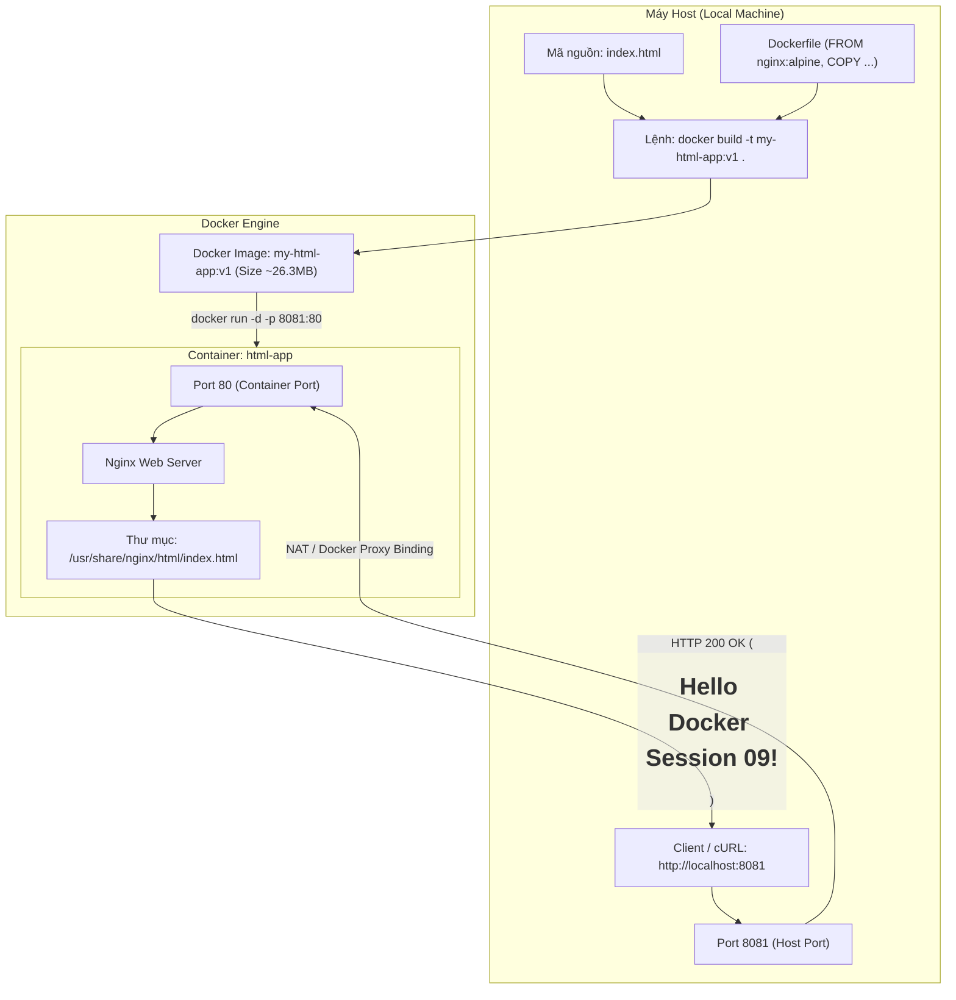

# Báo Cáo Thực Hành: Đóng Gói Trang Web HTML Tĩnh Bằng Dockerfile & Nginx Alpine

- **Khóa học:** DevOps / Cloud Engineering
- **Bài tập:** Session 09 - Bài 3: Viết Dockerfile 3 dòng đóng gói trang Web HTML tĩnh
- **Đường dẫn nộp bài trên GitHub:** `homework/session_09/ex3/`
- **Học viên:** Hoàng Văn Lương
- **Công nghệ sử dụng:** Docker, Nginx (Alpine Linux base), HTML5, cURL
- **Tệp tin đính kèm:**
  - `index.html` (Trang HTML tĩnh chứa nội dung hiển thị)
  - `Dockerfile` (Tệp chỉ dẫn đóng gói ứng dụng web vào container image)
  - `README.md` (Báo cáo thực hành chi tiết và hướng dẫn kiểm thử)

---

## 1. Mục Tiêu Bài Tập

1. **Hiểu rõ nguyên lý Containerization cho Web tĩnh:** Nắm vững cách thức đóng gói mã nguồn HTML tĩnh cùng với Web Server (Nginx) thành một đơn vị độc lập (Docker Image), có thể chạy nhất quán trên mọi môi trường mà không phụ thuộc vào cấu hình máy host.
2. **Tối ưu hóa Dockerfile với Base Image siêu nhẹ (Lightweight Image):** Sử dụng `nginx:alpine` dựa trên Alpine Linux nhằm giảm thiểu dung lượng image (~26MB thay vì ~190MB của Debian), tăng tốc độ kéo/đẩy image và thu hẹp bề mặt tấn công bảo mật (attack surface).
3. **Thành thạo các chỉ thị cơ bản trong Dockerfile:**
   - `FROM`: Chỉ định image nền tảng.
   - `COPY`: Sao chép tệp tin từ máy chủ cục bộ (Host) vào thư mục gốc phân phối web của Nginx (`/usr/share/nginx/html/`).
4. **Vận hành quy trình Build và Run Container:**
   - Thực thi `docker build` để đóng gói image với tag định danh `my-html-app:v1`.
   - Khởi chạy container ngầm (`-d`) và ánh xạ cổng mạng (`-p 8081:80`).
   - Kiểm thử xác thực bằng `curl http://localhost:8081` và đối soát kết quả trả về chính xác chuỗi `<h1>Hello Docker Session 09!</h1>`.

---

## 2. Kiến Trúc Hệ Thống & Luồng Xử Lý Mạng

### 2.1. Sơ Đồ Kiến Trúc Đóng Gói & Luồng Dữ Liệu (Traffic Flow)



### 2.2. Phân Tích Kỹ Thuật Chỉ Thị Dockerfile

Tệp `Dockerfile` được thiết kế tối giản, tập trung vào tính hiệu quả cao:

| Dòng lệnh | Cú pháp | Phân tích chức năng |
| :--- | :--- | :--- |
| **Dòng 1** | `FROM nginx:alpine` | Sử dụng image chính thức của Nginx phiên bản rút gọn trên nền Alpine Linux. Cung cấp sẵn Web Server Nginx đã được tinh chỉnh, bảo mật và siêu nhẹ (chỉ ~26.3MB). |
| **Dòng 2** | `COPY index.html /usr/share/nginx/html/index.html` | Sao chép tệp `index.html` từ thư mục build context trên host vào đúng thư mục phục vụ tài liệu mặc định (Document Root) của Nginx Alpine, ghi đè tệp index mặc định của Nginx. |

> [!NOTE]
> Mặc dù Nginx mặc định lắng nghe tại cổng `80` và đã có lệnh khởi động `CMD ["nginx", "-g", "daemon off;"]` trong base image `nginx:alpine`, nên Dockerfile chỉ cần 2 câu lệnh cốt lõi là đã hoàn thiện việc đóng gói ứng dụng.

---

## 3. Chi Tiết Tệp Nguồn

### 3.1. Tệp `index.html`

```html
<h1>Hello Docker Session 09!</h1>
```

### 3.2. Tệp `Dockerfile`

```dockerfile
FROM nginx:alpine
COPY index.html /usr/share/nginx/html/index.html
```

---

## 4. Hướng Dẫn Thực Thi Từng Bước & Kiểm Tra Xác Thực

### Bước 1: Chuẩn bị thư mục và tệp tin

Di chuyển vào thư mục bài tập:
```bash
cd homework/session_09/ex3
```

Đảm bảo cấu trúc thư mục gồm đủ các tệp:
```text
homework/session_09/ex3/
├── Dockerfile
├── index.html
└── README.md
```

---

### Bước 2: Build Docker Image

Thực thi lệnh đóng gói image với tên `my-html-app:v1`:
```bash
docker build -t my-html-app:v1 .
```

**Kết quả ghi nhận:**
```text
[+] Building 7.5s (7/7) FINISHED
 => [internal] load build definition from Dockerfile
 => [internal] load metadata for docker.io/library/nginx:alpine
 => [internal] load build context
 => [1/2] FROM docker.io/library/nginx:alpine
 => [2/2] COPY index.html /usr/share/nginx/html/index.html
 => exporting to image
 => => naming to docker.io/library/my-html-app:v1
```

Kiểm tra kích thước image vừa build:
```bash
docker images my-html-app:v1
```
*Dung lượng image đạt ~26.3MB, cực kỳ gọn nhẹ.*

---

### Bước 3: Khởi chạy Docker Container

Chạy container từ image `my-html-app:v1` với tên `html-app`, ánh xạ cổng `8081` trên máy host vào cổng `80` của container:
```bash
docker run -d -p 8081:80 --name html-app my-html-app:v1
```

**Giải thích các tham số:**
- `-d` (*detached mode*): Cho phép container chạy ngầm trong nền, giải phóng cửa sổ terminal.
- `-p 8081:80` (*publish port*): Ánh xạ cổng `8081` của máy host tới cổng `80` của container Nginx.
- `--name html-app`: Đặt tên tường minh cho container để thuận tiện quản lý (`docker stop`, `docker logs`, v.v.).
- `my-html-app:v1`: Image sử dụng để tạo container.

Kiểm tra trạng thái container đang chạy:
```bash
docker ps --filter "name=html-app"
```

**Output mẫu:**
```text
CONTAINER ID   IMAGE            COMMAND                  STATUS          PORTS                                     NAMES
b57078124ccb   my-html-app:v1   "/docker-entrypoint.…"   Up 15 seconds   0.0.0.0:8081->80/tcp, [::]:8081->80/tcp   html-app
```

---

### Bước 4: Kiểm tra và xác thực kết quả (Testing)

Sử dụng lệnh `curl` để gửi yêu cầu HTTP tới cổng `8081` trên máy host:
```bash
curl http://localhost:8081
```

**Kết quả trả về:**
```html
<h1>Hello Docker Session 09!</h1>
```

Kiểm tra chi tiết phản hồi HTTP Header bằng tham số `-i`:
```bash
curl -i http://localhost:8081
```

**Output phản hồi từ Nginx:**
```http
HTTP/1.1 200 OK
Server: nginx/1.31.6
Date: Thu, 08 Oct 2026 18:32:03 GMT
Content-Type: text/html
Content-Length: 34
Last-Modified: Thu, 08 Oct 2026 18:31:37 GMT
Connection: keep-alive
ETag: "6ac7e189-22"
Accept-Ranges: bytes

<h1>Hello Docker Session 09!</h1>
```

Kiểm tra access log trên container:
```bash
docker logs html-app
```
**Nhật ký Nginx ghi nhận:**
```text
192.168.65.1 - - [08/Oct/2026:18:32:03 +0000] "GET / HTTP/1.1" 200 34 "-" "curl/8.7.1" "-"
```

---

### Bước 5: Các lệnh quản trị & Dọn dẹp (Optional)

Khi muốn dừng hoặc dọn dẹp container và image sau khi kiểm tra xong:

```bash
# Dừng container
docker stop html-app

# Xóa container
docker rm html-app

# Xóa image vừa build nếu không còn nhu cầu sử dụng
docker rmi my-html-app:v1
```

---

## 5. Tổng Kết Kiến Thức Trọng Tâm

1. **Hiệu suất đóng gói:** Việc tận dụng các base image chuyên dụng như `nginx:alpine` giúp tiết kiệm băng thông và tài nguyên lưu trữ rất lớn so với việc cài đặt OS đầy đủ.
2. **Kế thừa thiết lập (Base Image Inheritance):** Nginx container image đã cài đặt sẵn tiến trình chạy ngầm, file cấu hình `/etc/nginx/nginx.conf` và các biến môi trường cần thiết, do đó ứng dụng web tĩnh chỉ cần tập trung vào việc đặt tệp nguồn đúng thư mục Document Root.
3. **Phân tách môi trường:** Khác với việc cài đặt Nginx trực tiếp lên máy Host (dễ gây xung đột cổng, thư viện và phiên bản), Docker cô lập hoàn toàn môi trường phục vụ web vào bên trong container.
